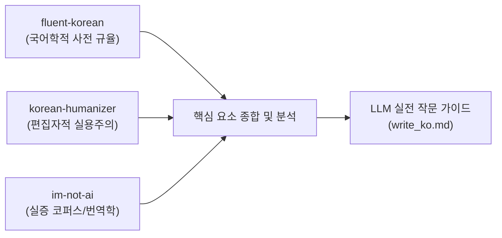

# Make AI More Korean (한국어 AI 글쓰기 유창성 개선 프로젝트)

AI(LLM)가 생성하는 한국어 텍스트의 부자연스러움(번역투, 텔레그래픽 문체, 기계적 병렬, AI 고빈도 어휘 등)을 극복하고, 한국어 모국어 화자 수준의 유창하고 자연스러운 글을 쓸 수 있도록 연구·정리한 프로젝트입니다.

---

## 📌 프로젝트 진행 과정

본 프로젝트는 오픈소스 생태계에서 한국어 AI 텍스트 개선을 선도해 온 세 가지 대표 프로젝트를 포크 및 분석하고, 각 프로젝트의 고유한 철학과 데이터를 종합하여 실전 작문 가이드([`write_ko.md`](write_ko.md))를 도출하는 과정으로 진행되었습니다.



### 1단계: 원본 저장소 Fork 및 분석 대상 선정
GitHub CLI(`gh`)를 통해 세 저장소를 GitHub 사용자 계정(`Lbin91`)으로 포크하여 각 프로젝트의 규칙과 코퍼스를 분석했습니다:

- **`fluent-korean`**: [snflkd/fluent-korean](https://github.com/snflkd/fluent-korean) → [Lbin91/fluent-korean](https://github.com/Lbin91/fluent-korean)
- **`korean-humanizer`**: [dotoricode/korean-humanizer](https://github.com/dotoricode/korean-humanizer) → [Lbin91/korean-humanizer](https://github.com/Lbin91/korean-humanizer)
- **`im-not-ai`**: [epoko77-ai/im-not-ai](https://github.com/epoko77-ai/im-not-ai) → [Lbin91/im-not-ai](https://github.com/Lbin91/im-not-ai)

### 2단계: 프로젝트별 핵심 요소 심층 분석
세 프로젝트가 제시하는 접근법과 실증 연구를 비교 분석하였습니다:
- **`fluent-korean`**: 코딩 에이전트의 토큰 압축 압박으로 파괴된 조사/어미 생략과 전보문체를 복원하고, 관형격 조사 `~의` 남발을 억제하는 국어국문학적 사전 규율(output-style).
- **`korean-humanizer`**: 6대 간결화 기준(`있다`, `것`, `수`, `접속사`, 군더더기 문장), 도메인별 종결어미 톤(레지스터) 엄격 보존, 쉼표 사용 패턴(KatFish 연구)을 반영한 실용적 편집.
- **`im-not-ai`**: 한국 번역학 8대 계보와 대규모 대조 코퍼스 실측을 바탕으로 10대 카테고리 85개 패턴을 S1/S2/S3 심각도로 분류하고, 단순 빈도가 아닌 '문맥과 자리' 중심의 오탐 방지 체계.

### 3단계: LLM 실전 작문 지침 수립 ([`write_ko.md`](write_ko.md))
위 분석 결과를 집대성하여, LLM이 시스템 프롬프트나 작문 지침으로 직접 참고하여 즉시 고품질 한국어를 출력할 수 있도록 구성된 실전 지침서를 완성했습니다:
- **절대 원칙**: 원문의 팩트·수치·의도 보존 및 서법(확신 vs 추정) 왜곡 방지
- **통사·구문 규칙**: 영형 주어 자연화, 무생물 주어 물칭구문 해체, 긴 좌향 수식 분리, 능동태 지향
- **담화·리듬 규칙**: 단문과 복문의 교차, 기계적 3단 병렬 파괴, 문두 접속사 절제, 연결어미 뒤 쉼표 제거
- **어휘 치환 사전**: 공허한 형용사, 과장된 수사, AI 시그니처 고빈도어 대체 표
- **도메인별 레지스터 가이드**: 기술 문서, 비즈니스 보고, 블로그, 영상 발화체별 종결어미 매뉴얼
- **자가 검증 체크리스트**: 출력 전 7가지 검증 항목

---

## 📂 파일 구조

```
make_ai_more_korean/
├── README.md          # 프로젝트 개요, 분석 과정 및 사용 안내
├── write_ko.md        # LLM 입력용 실전 한국어 글쓰기 종합 가이드라인
└── LICENSE            # MIT 라이선스 전문 및 제3자 라이선스/출처 표기
```

---

## 🚀 활용 방법 (`write_ko.md`)

### 1. ChatGPT / Claude / Gemini 웹 커스텀 지침
- [write_ko.md](write_ko.md) 파일의 내용을 복사하여 플랫폼별 **Custom Instructions** 또는 **프로필/개인화 지침**에 등록합니다.

### 2. Claude Code / CLI 코딩 에이전트
- 프로젝트 루트 디렉터리의 `CLAUDE.md` 또는 `~/.claude/output-styles/`에 본 지침을 포함하여 에이전트의 한국어 보고 및 주석 작성을 자연스럽게 유도합니다.

### 3. 개별 프롬프트 주입
- 한국어 보고서, 기술 블로그 아티클, 번역 검수 등을 요청할 때 프롬프트 상단에 [write_ko.md](write_ko.md)를 컨텍스트로 제공합니다.

---

## 📜 라이선스 및 출처 (License & Attribution)

본 프로젝트는 **[MIT License](LICENSE)** 를 따릅니다. 세부 라이선스 전문은 [LICENSE](LICENSE) 파일에서 확인하실 수 있습니다.

본 프로젝트의 분석 및 지침 수립은 다음 세 오픈소스 프로젝트의 지적 자산과 연구 성과를 바탕으로 이루어졌습니다. 훌륭한 연구를 공개해 주신 원작자분들께 깊은 감사를 드립니다.

1. **[snflkd/fluent-korean](https://github.com/snflkd/fluent-korean)** (MIT License, Copyright (c) 2026 snflkd)
2. **[dotoricode/korean-humanizer](https://github.com/dotoricode/korean-humanizer)** (MIT License, Copyright (c) 2026 dotoricode)
3. **[epoko77-ai/im-not-ai](https://github.com/epoko77-ai/im-not-ai)** (MIT License, Copyright (c) 2026 epoko77-ai)
